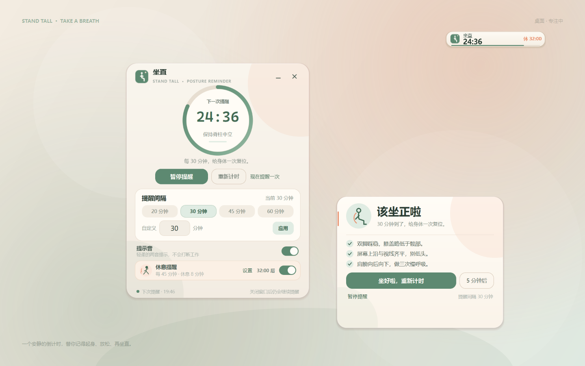
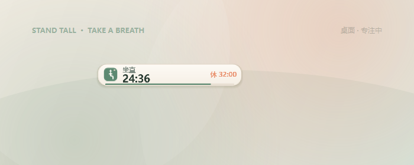
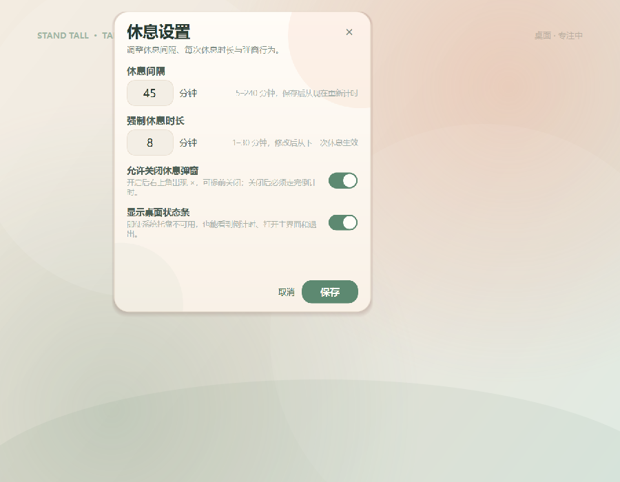
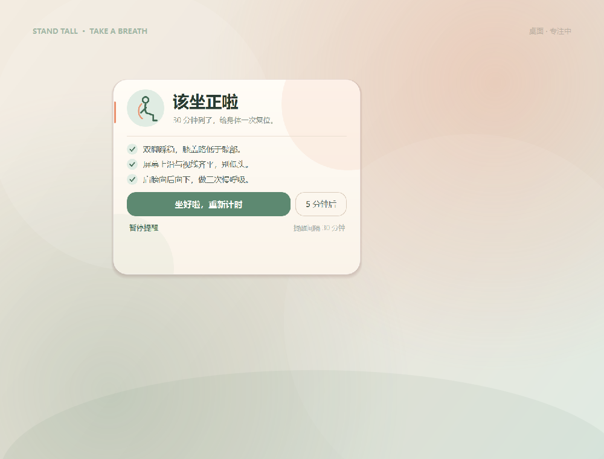
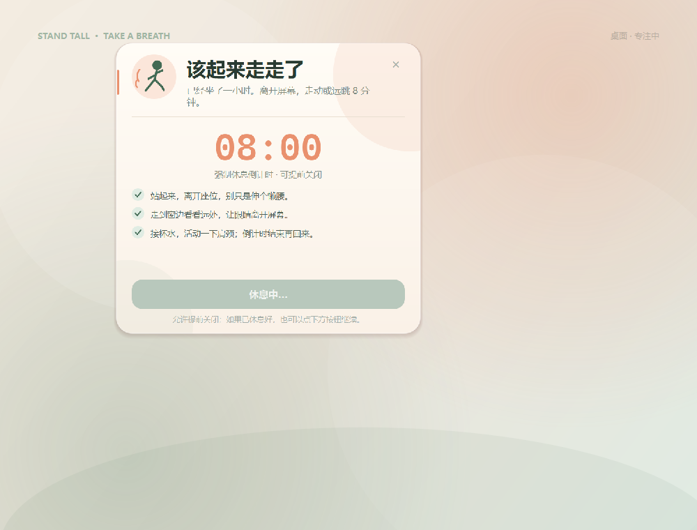

# StandTall

[中文](README.md) · English

A quiet Windows posture and break reminder that stays out of the way. When the posture timer reaches zero, StandTall shows a gentle reminder card. After each break interval (60 minutes by default), it opens a walking-break countdown card. Both the break interval and the break duration are configurable, and you can choose whether the break overlay may be closed early.

It also has an independent **always-on-top desktop status bar**. Even when Windows does not register a system tray icon, you can still see both countdowns, open the main window, start a break, and quit the app.

The posture interval is adjustable from 1 minute to 4 hours. The forced-break interval defaults to 60 minutes and can be set between 5 and 240 minutes; each break can last from 1 to 30 minutes.



> StandTall does not use a camera to detect posture and does not monitor your screen. It is a reliable timer with a non-intrusive reminder card.
>
> The application UI is currently in Chinese. This document is the English guide.

---

## Features

- **Adjustable posture interval** — 1–240 minutes, with direct input and one-click 20 / 30 / 45 / 60 minute presets.
- **Configurable forced breaks** — 5–240 minute interval (default 60), 1–30 minute duration (default 5).
- **Optional early close** — choose whether the break overlay may be closed before its countdown ends. When disabled, the overlay cannot be dismissed; when enabled, an × appears in the top-right corner.
- **Desktop status bar** — an independent, always-on-top bar that always shows the posture countdown and next break. It can open the main window, pause/resume, start a break, open settings, and quit even when the tray icon is unavailable.
- **Pause / resume** — pause posture reminders for meetings or time away; forced breaks continue independently.
- **Snooze** — when a posture reminder appears, postpone it for 5 minutes.
- **Reset** — start the current posture interval from zero.
- **Remind now** — preview the posture reminder card immediately.
- **Tray support** — closing the window stops neither the timer nor the tray presence. The tray can start a break and shows the next reminder state.
- **Gentle reminder card** — posture reminders appear at the bottom-right of the screen without stealing keyboard focus. Break overlays are centered, always on top, and intentionally take focus.
- **Chime** — a soft two-tone sound is synthesized locally and can be disabled. No external audio assets.
- **Persistent settings** — posture interval, sound, break enabled state, break interval, break duration, early-close permission, and status bar visibility are remembered.
- **Single instance** — opening StandTall again raises the existing window instead of starting a second timer.
- **Sleep recovery** — if the computer sleeps through a reminder, the next tick after wake-up catches up instead of silently skipping it.
- **No network, account, or telemetry.**

## Run the portable build

Unzip `dist\StandTall-Portable.zip` and run:

```text
StandTallPortable-1.3.0.exe
```

> This is a portable directory build. The `_internal` folder next to the executable is part of the application. **Do not copy the exe by itself.**
>
> If an older version is running, quit it first. Launch StandTall from the normal desktop or `Win+R`; avoid low-integrity or sandboxed file managers. The desktop status bar is enabled by default.

From the current checkout, you can also run:

```text
dist\StandTallPortable-1.3.0\StandTallPortable-1.3.0.exe
```

## Run from source

Requirements: Windows 10/11 and 64-bit Python 3.11.

```powershell
py -3.11 -m venv .venv
.\.venv\Scripts\python.exe -m pip install -r requirements.txt
.\.venv\Scripts\python.exe main.py
```

Alternatively:

```powershell
.\.venv\Scripts\python.exe -m standtall
```

First launch defaults: 30-minute posture interval, 60-minute break interval, 5-minute break duration.

## Usage

| Action | Result |
| --- | --- |
| Change posture interval | Click the 20/30/45/60 minute presets, or enter 1–240 under “Custom” and click “Apply”. |
| Change break settings | Click **Settings** on the “Break reminder” card. Set a 5–240 minute trigger interval, a 1–30 minute duration, early-close permission, and status bar visibility. |
| Pause reminders | Main window → “Pause reminders”, or the tray/status bar menu. |
| Resume reminders | Click “Resume reminders” after pausing. |
| Reset | Main window → “Reset” starts the current posture interval from the beginning. |
| Trigger a posture reminder | A card appears at the bottom-right with “I'm sitting up”, “Snooze 5 min”, or “Pause reminders”. |
| Forced break | A centered break card appears at the configured interval (default 60 minutes). Duration is also configurable; click “Break complete, continue” after the countdown. |
| Disable automatic breaks | Toggle the switch on the “Break reminder” card. It is on by default. |
| Start a break now | Tray menu → “Start a break now”, or the status bar right-click menu. |
| Close the window | Hides to the desktop status bar/tray; the timer continues. |
| Open the main window | Click/double-click the status bar, or use “Open StandTall” in the tray menu. |
| Quit | Status bar right-click menu → “Quit”, or the tray menu → “Quit”. |

The posture reminder card contains three simple prompts:

1. Keep both feet flat; knees slightly below the hips.
2. Put the top of the screen at eye level; avoid looking down.
3. Move shoulders back and down; take three slow breaths.

### Break rules

- The break interval is adjustable between **5 and 240 minutes**; default 60. Saving a new interval restarts the current countdown from that moment.
- The break duration is adjustable between **1 and 30 minutes**; default 5. A new duration applies from the next break.
- By default, early close is disabled. The card is application-modal and always on top, takes focus, and has no close, skip, or snooze button. `Esc` and `Alt+F4` do not dismiss it.
- If **Allow closing the break overlay** is enabled, an × appears in the top-right and `Esc` can end the break early. The next break still follows the configured interval.
- Completing or ending a break resets the posture timer and starts the next break at the configured interval. If posture reminders were paused before the break, they remain paused.
- If a posture reminder is showing when a break begins, the posture card is hidden first so the two reminders never overlap.
- Automatic breaks can be disabled from the main window. “Start a break now” remains available in the tray/status bar menu.
- All settings are persisted immediately and restored on the next launch.

### Desktop status bar

Windows may not show a system tray icon in some low-integrity, remote-desktop, or taskbar-restart scenarios. The desktop status bar does not depend on `Shell_NotifyIcon`, so it remains visible:



- Always on top; drag it anywhere you like.
- Shows the posture countdown and the next break countdown.
- Click to open the main window. Right-click for pause/resume, start a break, break settings, or quit.
- It stays visible when the main window is closed, so there is always a way back.
- You can turn it off in **Break settings**.



## Build the portable app

```powershell
.\.venv\Scripts\python.exe -m pip install -r requirements-dev.txt
powershell -ExecutionPolicy Bypass -File .\build.ps1
```

Outputs:

```text
dist\StandTallPortable-1.3.0\StandTallPortable-1.3.0.exe
dist\StandTall-Portable.zip
```

The build script:

1. Checks dependencies.
2. Generates the application icon.
3. Runs the full test suite with headless Qt.
4. Builds a PyInstaller **onedir** portable bundle.
5. Runs the packaged exe with `--smoke-test` to confirm it starts and exits cleanly.
6. Creates the distribution zip.

The onedir build starts faster than a one-file build and does not extract the Qt runtime into the system temp directory, which is more reliable on machines with restricted temp permissions. Keep the entire `StandTallPortable-1.3.0` folder, including `_internal`.

If the system tray is unavailable, the desktop status bar remains available. If the user disables the status bar and the tray is also unavailable, closing the main window exits the application rather than leaving an unreachable process.

## Tests

```powershell
$env:QT_QPA_PLATFORM = "offscreen"
.\.venv\Scripts\python.exe -m pytest -q
```

Regenerate the README previews (uses the Windows Qt platform without showing windows or capturing the real desktop):

```powershell
.\.venv\Scripts\python.exe scripts\render_standtall_previews.py
```

Coverage includes:

- Countdown behavior; one-shot expiry; pause/resume preserving remaining time.
- 5-minute snooze; interval changes; reset while waiting for acknowledgement.
- Configurable 5–240 minute break interval and 1–30 minute break duration.
- Interval changes restarting the countdown; no duplicate expiry; interval reset after completion.
- Break duration, early-close switch, settings defaults, and persistence.
- Desktop status bar rendering and state updates; break settings dialog.
- QSettings persistence, range clamping, and invalid-value fallbacks.
- Synthesized WAV chime.
- Main window, reminder card, break countdown, progress ring, and custom widgets under headless Qt.

Windows tray behavior depends on notification-area permissions and process integrity. In some sessions `Shell_NotifyIcon` may be rejected with Access Denied; the desktop status bar is the independent, visible fallback.

## Project layout

```text
.
├── main.py                         # launcher
├── README.md / README.en.md        # Chinese / English
├── standtall/
│   ├── main.py                     # arguments, single instance, exception handling
│   ├── app.py                      # timer → windows/tray controller
│   ├── core/countdown.py           # pure countdown state machine (injectable clock)
│   ├── core/rest.py                # configurable forced-break schedule
│   ├── services/
│   │   ├── settings.py             # QSettings persistence
│   │   ├── sound.py                # synthesized chime + Windows playback
│   │   ├── single_instance.py      # local IPC, brings back the existing window
│   │   ├── paths.py                # %LOCALAPPDATA%\StandTall
│   │   └── logging_setup.py        # local rotating log
│   └── ui/
│       ├── theme.py                # cream + sage visual language
│       ├── widgets.py              # progress ring, switches, hand-drawn icon buttons
│       ├── icons.py                # runtime QIcon (active/paused/attention)
│       ├── main_window.py          # main panel, countdown ring, break settings entry
│       ├── reminder_window.py      # bottom-right gentle reminder card
│       ├── rest_window.py          # configurable, optionally closable break card
│       ├── break_settings.py       # break interval/duration/close/status bar settings
│       ├── status_bar.py           # independent always-on-top desktop status bar
│       └── tray.py                 # system tray
├── standtall_tests/                # pytest / pytest-qt tests
├── scripts/
│   ├── make_standtall_icon.py      # generates PNG/ICO for the exe
│   └── render_standtall_previews.py
├── assets/                         # packaged icons
├── build.ps1
└── requirements*.txt
```

### Timing model

The core lives in `standtall/core/countdown.py` and has no Qt dependency:

- Each run stores a wall-clock deadline; the UI polls every 250 ms.
- On expiry the state becomes `WAITING`; it **does not remind repeatedly** until the user responds.
- “I'm sitting up” starts a new full interval.
- “Snooze 5 min” uses a temporary 5-minute cycle, then returns to the normal interval.
- Pausing stores the remaining seconds; resuming restores them.
- Changing the interval while waiting saves the new value and applies it after the next reset.
- Reminder cards do not disappear automatically, so they are not missed in a moment of inattention.

### Data locations

- Settings: Windows registry `HKEY_CURRENT_USER\Software\StandTall\StandTall`
- Logs: `%LOCALAPPDATA%\StandTall\logs\standtall.log`
- Synthesized chime: `%LOCALAPPDATA%\StandTall\chime.wav`
- If `%LOCALAPPDATA%\StandTall` is not writable, StandTall falls back to a `StandTallData\` folder next to the executable (common for portable builds).

Deleting `%LOCALAPPDATA%\StandTall` clears the logs and chime; settings can be removed from the matching registry key. The app stores no screen, keyboard, or camera data.

## Design notes

- The main window uses a cream-paper and sage-green palette to avoid the preachy feel common in health apps.
- Reminder cards appear at the bottom-right of the screen under the cursor and use `WA_ShowWithoutActivating`, so they do not steal focus.
- The progress ring uses the remaining ratio as its arc; it turns gray with a dashed style when paused and coral when waiting.
- All icons and sounds are generated in code; there are no third-party assets or network requests.
- UI and timing logic are separated. Future additions such as work hours, lunch do-not-disturb, or start-at-login only need settings and countdown policy changes, not a UI rewrite.

## Known limitations

- This is a **timer**, not a posture sensor. It does not detect whether you are actually sitting upright or whether you actually left your seat, and it does not access a camera.
- The break overlay is application-modal and always on top, not an operating-system lock. You can still quit the app from the status bar or tray.
- The break interval defaults to 60 minutes and can be set to 5–240 minutes; the break duration can be set to 1–30 minutes.
- There is currently no start-at-login option.
- On Windows the chime is played with `winsound`; other platforms are silent but the UI still runs.
- Whether a system tray icon appears depends on Windows notification-area permissions and process integrity. A low-integrity process may receive Access Denied from `Shell_NotifyIcon`; the desktop status bar remains visible and independent.
- If the user disables the desktop status bar and the system tray is unavailable, closing the main window exits the app to avoid an unreachable process.
- The portable build requires the `_internal` folder; do not copy the exe alone.
- The application UI is currently Chinese. This README is the English documentation.

## Screenshots






