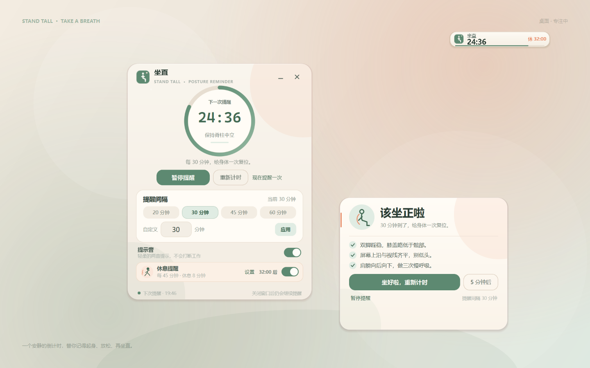
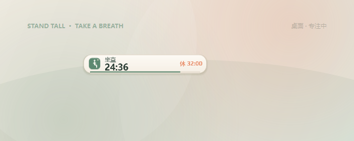
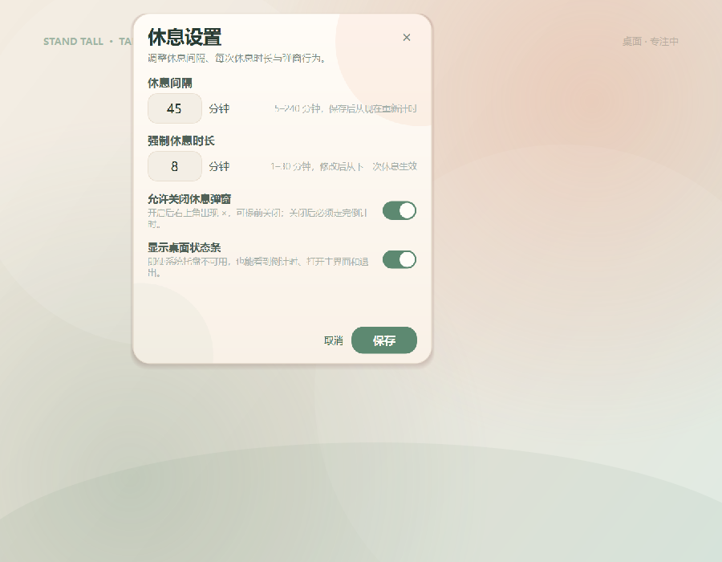
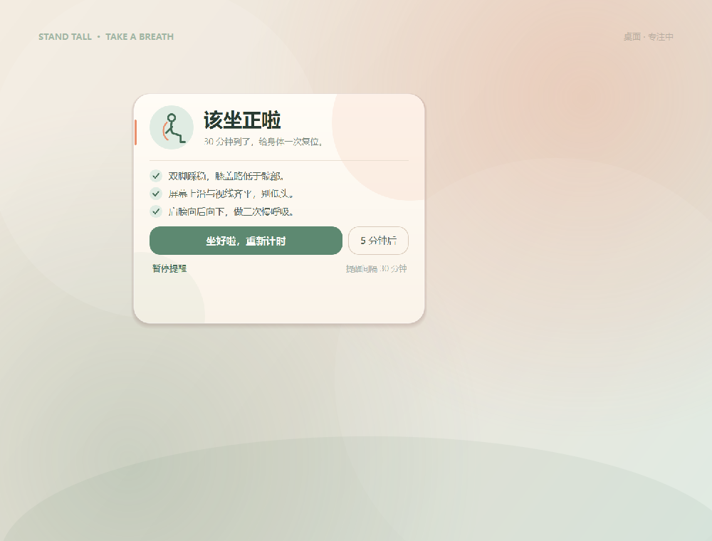
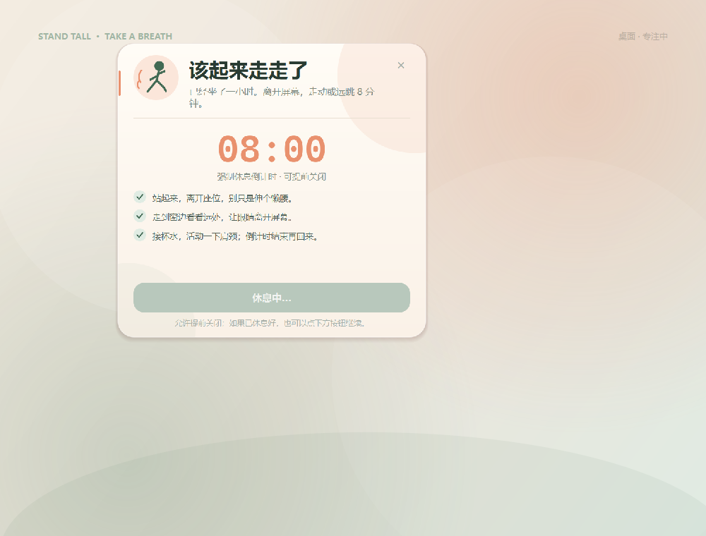

# 坐直 · StandTall

一个安静、常驻桌面的 Windows 坐姿与休息提醒工具。坐姿计时到达时，它弹出一张轻提示卡；每坐满一小时，它会强制出现一张走动休息倒计时卡。休息时长可调，是否允许提前关闭也可在设置里选择。

它还有一个独立的**桌面状态条**：即使 Windows 系统托盘不注册图标，也能始终看到倒计时、打开主界面、开始休息和退出。

坐姿提醒间隔完全可调，从 1 分钟到 4 小时；强制休息默认每 60 分钟触发一次，**触发间隔和每次休息时长都可以自定义**。



> 它不会摄像头识别坐姿，也不会监控你的屏幕。它只是一个可靠的计时器和一张不打扰人的提醒卡。

---

## 功能

- **自定义提醒间隔**：1–240 分钟，支持直接输入；常用 20 / 30 / 45 / 60 分钟一键切换。
- **可调强制休息**：触发间隔 5–240 分钟（默认 60），每次休息 1–30 分钟（默认 5）。
- **可关闭开关**：设置里可选择是否允许提前关闭强制休息弹窗。关闭时仍然必须等倒计时结束；开启后弹窗右上角会出现 ×。
- **桌面状态条**：独立的置顶小条，始终显示坐姿倒计时和下一次休息；托盘图标不出现时也能打开主界面、暂停、开始休息、改设置和退出。
- **暂停 / 继续**：开会、外出时可以暂停坐姿提醒，回来再继续；强制休息仍会独立运行。
- **稍后提醒**：坐姿到点后可选择「5 分钟后」再提醒一次。
- **重新计时**：手动从头开始当前坐姿间隔。
- **现在提醒一次**：随时预览坐姿提醒卡片。
- **托盘常驻**：关闭窗口不会停止提醒；托盘可立即开始一次休息，也会显示下一次状态。
- **轻提示卡**：坐姿提醒显示在屏幕右下角，不抢输入焦点；强制休息卡居中、置顶，并会主动获得焦点。
- **提示音**：程序自动合成一段柔和的两音提示，可随时关闭。没有外部音频素材。
- **设置持久化**：坐姿间隔、提示音、强制休息开关、休息时长、弹窗关闭权限和状态条开关都会保留到下一次启动。
- **单实例**：重复打开时唤回已经运行的窗口，不会出现两个计时器并发提醒。
- **睡眠恢复**：电脑休眠错过提醒时，唤醒后的下一次 tick 会立即补上提醒，而不是悄悄跳过。
- **无网络、无账号、无遥测**。

## 直接运行（推荐）

解压 `dist\StandTall-Portable.zip`，双击其中的 `StandTallPortable-1.3.0.exe`。

> 这是便携目录版：exe 旁边的 `_internal` 文件夹是程序的一部分，**不要只单独复制 exe**。整个文件夹可以放到任意位置。
> 如果旧版还在运行，请先退出旧版。建议从正常桌面或 `Win+R` 启动，避免从低权限/沙箱文件管理器启动；新版默认显示桌面状态条。

已经在运行本机环境时，也可以直接双击：

```text
dist\StandTallPortable-1.3.0\StandTallPortable-1.3.0.exe
```

## 从源码运行

需要 Windows 10/11 和 Python 3.11（64 位）。

```powershell
py -3.11 -m venv .venv
.\.venv\Scripts\python.exe -m pip install -r requirements.txt
.\.venv\Scripts\python.exe main.py
```

也可以：

```powershell
.\.venv\Scripts\python.exe -m standtall
```

首次启动默认每 **30 分钟**提醒一次。

## 使用

| 操作 | 效果 |
| --- | --- |
| 修改间隔 | 点击 20/30/45/60 分钟预设，或在「自定义」中输入 1–240 后点「应用」 |
| 修改休息设置 | 主界面「休息提醒」卡片上的「设置」，可改 5–240 分钟触发间隔、1–30 分钟休息时长、是否允许关闭弹窗、是否显示状态条 |
| 暂停提醒 | 主窗口的「暂停提醒」，或托盘/状态条菜单 |
| 继续提醒 | 暂停后点「继续提醒」 |
| 重新计时 | 主窗口的「重新计时」，按当前间隔从头开始 |
| 到点提醒 | 右下角弹出坐姿提醒卡，可选择「坐好啦」「5 分钟后」或「暂停提醒」 |
| 强制休息 | 按设置的间隔（默认 60 分钟）居中弹出休息卡；时长也由设置决定，结束后点「休息完成，继续工作」 |
| 关闭强制休息 | 主界面「休息提醒」右侧开关；默认开启 |
| 立即休息 | 托盘菜单 →「现在开始休息」，或状态条右键菜单 |
| 关闭窗口 | 收起到桌面状态条/托盘，计时继续 |
| 打开主界面 | 单击/双击状态条，或托盘菜单「打开坐直」 |
| 退出 | 状态条右键菜单 →「退出」，或托盘菜单「退出」 |

坐姿提醒卡上有三条简单的坐姿提示：

1. 双脚踩稳，膝盖略低于髋部。
2. 屏幕上沿与视线齐平，别低头。
3. 肩膀向后向下，做三次慢呼吸。

### 强制休息规则

- 休息间隔可在 **5–240 分钟** 之间调整，默认 60 分钟；保存后从当前时间重新计时。
- 休息时长在 **1–30 分钟** 之间调整，默认 5 分钟；从下一次休息开始生效。
- 默认不允许提前关闭：卡片应用级模态 + 始终置顶，主动获取焦点，没有关闭/跳过/稍后按钮，Esc 或 Alt+F4 不会关掉它。
- 如果在设置里开启 **允许关闭休息弹窗**，卡片右上角会出现 ×，也可以按 Esc 提前结束；提前结束后下一轮仍按当前设置的休息间隔开始。
- 完成或提前结束休息后都会重置坐姿计时，并按当前设置的休息间隔开始下一轮。
- 强制休息出现时，如果坐姿提醒正弹着，会先收起坐姿卡片，避免两张提醒叠在一起。
- 可在主界面关闭自动强制休息，关闭后托盘/状态条的「现在开始休息」仍然可用。
- 所有设置都会立即持久化，下次启动继续生效。

### 桌面状态条

如果 Windows 系统托盘没有显示图标（部分低权限启动、远程桌面或任务栏异常会出现），桌面状态条不依赖 `Shell_NotifyIcon`，仍然会显示：



- 始终置顶；可以拖动到任意位置。
- 显示坐姿倒计时和「休 47:00」。
- 单击打开主界面；右键菜单可暂停/继续、现在开始休息、打开休息设置或退出。
- 主界面关闭后，状态条继续保留；不会出现“窗口关掉、托盘又找不到”的情况。
- 可在「休息设置」中关闭状态条。



## 打包为便携版

```powershell
.\.venv\Scripts\python.exe -m pip install -r requirements-dev.txt
powershell -ExecutionPolicy Bypass -File .\build.ps1
```

产物：

```text
dist\StandTallPortable-1.3.0\StandTallPortable-1.3.0.exe
dist\StandTall-Portable.zip
```

构建脚本会：

1. 检查依赖；
2. 生成应用图标；
3. 用无界面 Qt 运行全部测试；
4. 用 PyInstaller 的**目录模式**打包；
5. 启动打包后的 exe 做一次 `--smoke-test`，确认能初始化并正常退出；
6. 生成可分发的 zip。

使用目录模式而不是 one-file，是因为它启动更快，也不需要把 Qt 运行时解压到系统临时目录；在临时目录权限受限的机器上更可靠。代价是必须保留整个 `StandTallPortable-1.3.0` 文件夹以及其中的 `_internal`。

如果系统托盘不可用，桌面状态条会保留入口；如果用户在设置里关掉状态条，关闭主窗口时程序会直接退出，避免应用藏起来无法找回。

## 测试

```powershell
$env:QT_QPA_PLATFORM = "offscreen"
.\.venv\Scripts\python.exe -m pytest -q
```

重新生成 README 预览图（使用 Windows 平台但不显示窗口，也不会截取真实桌面）：

```powershell
.\.venv\Scripts\python.exe scripts\render_standtall_previews.py
```

测试覆盖：

- 倒计时、到点只触发一次、暂停/恢复保留剩余时间
- 5 分钟稍后提醒、修改间隔、等待确认后的重新计时
- 每小时强制休息、可自定义 5–240 分钟触发间隔、1–30 分钟休息时长
- 休息间隔修改后立即重新计时、错过一次后不重复触发、完成后的间隔重置
- 休息时长设置、可关闭弹窗开关、设置持久化和默认值
- 桌面状态条渲染、状态更新和设置对话框
- QSettings 持久化、范围限制和非法值回退
- 提示音 WAV 合成
- 主窗口、提醒卡、强制休息倒计时、进度环和自定义控件在无头 Qt 下渲染

系统托盘在部分 Windows 会话中可能因权限策略或任务栏状态无法注册；桌面状态条作为默认可见入口，不依赖系统托盘。

## 结构

```text
.
├── main.py                         # 启动入口
├── standtall/
│   ├── main.py                     # 参数、单实例、异常兜底
│   ├── app.py                      # 计时器 → 窗口/托盘控制器
│   ├── core/countdown.py           # 纯计时状态机（可注入时钟）
│   ├── core/rest.py                # 独立的一小时强制休息计时
│   ├── services/
│   │   ├── settings.py             # QSettings 持久化
│   │   ├── sound.py                # 合成柔和提示音 + Windows 播放
│   │   ├── single_instance.py      # 本地 IPC，唤回已有窗口
│   │   ├── paths.py                # %LOCALAPPDATA%\StandTall
│   │   └── logging_setup.py        # 本地滚动日志
│   └── ui/
│       ├── theme.py                # 奶油色 + 鼠尾草绿视觉
│       ├── widgets.py              # 进度环、开关、手绘图标按钮
│       ├── icons.py                # 运行时 QIcon（正常/暂停/等待）
│       ├── main_window.py          # 主面板、倒计时圆环、休息设置入口
│       ├── reminder_window.py      # 右下角轻提醒卡
│       ├── rest_window.py          # 可配置时长、可选关闭的强制休息卡
│       ├── break_settings.py       # 休息时长/关闭权限/状态条设置
│       ├── status_bar.py           # 独立置顶桌面状态条
│       └── tray.py                 # 系统托盘
├── standtall_tests/                # pytest / pytest-qt 测试
├── scripts/
│   ├── make_standtall_icon.py      # 生成 exe 用 PNG/ICO
│   └── render_standtall_previews.py
├── assets/                         # 打包图标
├── build.ps1
└── requirements*.txt
```

### 计时规则

核心在 `standtall/core/countdown.py`，不依赖 Qt：

- 每次运行保存一个 wall-clock deadline，界面每 250ms 查询一次；
- 到点后进入 `WAITING`，**不会重复提醒**，直到用户选择处理方式；
- 「坐好啦」→ 开始新的完整间隔；
- 「5 分钟后」→ 以 5 分钟为临时周期提醒一次，处理完后回到正常间隔；
- 暂停时保存剩余秒数，继续时恢复；
- 等待确认期间修改间隔会先保存新间隔，重新计时后生效；
- 通知卡不会自动消失，避免在一瞬间被忽略。

### 数据位置

- 设置：Windows 注册表 `HKEY_CURRENT_USER\Software\StandTall\StandTall`
- 日志：`%LOCALAPPDATA%\StandTall\logs\standtall.log`
- 合成提示音：`%LOCALAPPDATA%\StandTall\chime.wav`
- 如果 `%LOCALAPPDATA%\StandTall` 不可写，会自动回退到程序旁边的 `StandTallData\` 文件夹（便携版常见）。

删除 `%LOCALAPPDATA%\StandTall` 可以清理日志和提示音；设置可在注册表对应位置删除。应用不保存任何屏幕、键盘或摄像头数据。

## 设计说明

- 主界面采用奶油纸色 + 鼠尾草绿，减少“健康应用”常见的说教感。
- 提醒卡显示在光标所在屏幕的右下角，使用 `WA_ShowWithoutActivating`，弹出时不抢焦点。
- 进度环以剩余比例为弧长，暂停时变灰并显示虚线，到点变珊瑚色。
- 所有图标和提示音都由代码生成，没有第三方素材或网络请求。
- 界面与计时核心分离。以后增加“工作时段”“午休免打扰”“开机启动”，只需扩展设置和 `Countdown` 策略，不必重写 UI。

## 已知限制

- 这是一个**定时提醒器**，不检测你是否真的坐直或真的离开座位；也不访问摄像头。
- 强制休息是应用内模态 + 置顶，不是操作系统锁屏；仍可通过状态条/托盘退出应用。
- 强制休息默认每 60 分钟触发，触发间隔可在 5–240 分钟之间调整；单次休息时长可在 1–30 分钟之间选择。
- 当前没有开机自启动；需要的话可以后续加一个登录启动选项。
- 默认在 Windows 上使用 `winsound` 播放提示音，其他平台静音但 UI 仍可运行。
- 系统托盘是否显示取决于 Windows 的通知区域权限和启动完整性。低权限进程调用 `Shell_NotifyIcon` 可能被 Windows 拒绝（Access Denied）；此时桌面状态条仍然可见，不会依赖托盘。
- 如果用户主动关闭了桌面状态条，并且系统托盘不可用，关闭主窗口会直接退出，避免无入口。
- 便携版必须保留 `_internal` 文件夹，不能只拷贝 exe。

## 预览






